# TAKARKUY

**TAKARKUY** (Tata Kelola Anggaran dan Resep, Kuy!) adalah aplikasi web khusus untuk membantu pengguna merencanakan menu makanan yang sehat, hemat, dan minim limbah makanan. Berbeda dari aplikasi resep konvensional, TAKARKUY memulai perencanaan dari anggaran dan stok bahan yang sudah tersedia, kemudian menyusun rekomendasi menu untuk hari-hari selanjutnya.

**Aplikasi:** [alfredo-nathaniel-takarkuy.pws.cs.ui.ac.id](https://alfredo-nathaniel-takarkuy.pws.cs.ui.ac.id) · **Desain:** [Figma](https://www.figma.com/design/GbnAebmRymsFjgLebkKmUJ/PBPUY?node-id=0-1&t=6YqR0aO6YTlJA2SH-1) · **Data & API:** [DATA_API.md](DATA_API.md)

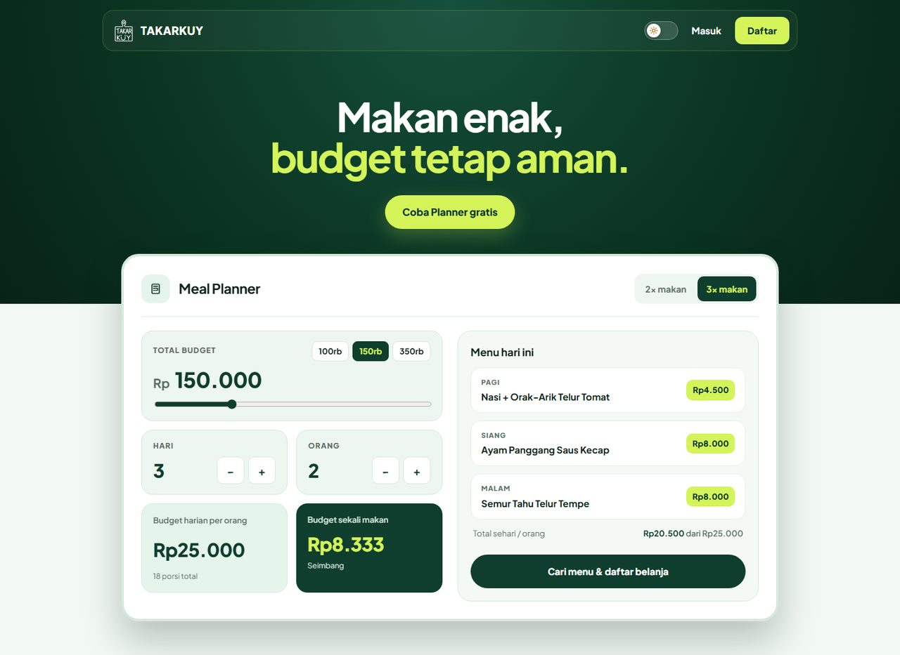

## Anggota Kelompok

| Nama | NPM |
| --- | --- |
| Alfredo Nathaniel Putra Harsono | 2506656412 |
| Alena Aura Deviyana | 2506656394 |
| Aiko Zahwa | 2506617140 |
| Attar Rais Hakam | 2506656495 |
| Rajendra Akbar Mahdiansyah | 2506596874 |

## Latar Belakang dan Value Proposition

### Visi

TAKARKUY bertujuan mendukung pola konsumsi pangan yang terencana, efisien secara finansial, dan ramah lingkungan. Aplikasi ini ingin membuat pola makan sehat yang terjangkau lebih mudah diakses masyarakat Indonesia tanpa menyisakan bahan makanan yang terbuang.

### Masalah yang Diselesaikan

- **Food waste rumah tangga:** bahan makanan terlupakan, kedaluwarsa, atau membusuk karena pengguna tidak tahu kapan harus mengolahnya.
- **Budget belanja tidak efisien:** pengguna kesulitan membagi anggaran makan harian atau mingguan secara realistis.
- **Nutrisi terabaikan demi hemat:** penghematan sering dilakukan dengan mengorbankan kualitas gizi.
- **Resep kurang fleksibel:** banyak aplikasi resep mengharuskan pengguna membeli bahan baru yang mahal atau tidak sesuai dengan kebiasaan masak lokal.

### Target Pengguna

- Mahasiswa dan anak kos yang membutuhkan menu bergizi dengan anggaran terbatas.
- Keluarga muda yang ingin mengoptimalkan pengeluaran dapur dan isi kulkas.
- Konsumen yang peduli lingkungan dan ingin mengurangi limbah makanan.

### Cara TAKARKUY Membantu

- **Ketika belum berbelanja:** pengguna menentukan budget dan target gizi, lalu TAKARKUY memberi saran bahan belanja serta menu.
- **Ketika sudah berbelanja:** pengguna memindai struk belanja atau memasukkan bahan secara manual, lalu TAKARKUY memanfaatkan stok tersebut untuk membantu pengguna memilih resep dan mencegah bahan terbuang.

## Perbandingan dengan Aplikasi Serupa

| Aspek | Cookpad (Indonesia) | SuperCook (Global) | Mealime (Global) | TAKARKUY |
| --- | --- | --- | --- | --- |
| Fokus utama | Komunitas dan resep | Pencocokan bahan dan resep | Perencanaan menu | Optimasi anggaran dan zero waste |
| Alur utama | Cari resep → beli bahan | Pilih bahan → dapat resep | Pilih menu → shopping list | Input budget → belanja + jadwal masak, atau input stok → pilih resep |
| Konteks bahan Indonesia | Ya | Terbatas | Terbatas | Ya, termasuk bahan dan bumbu lokal |
| Perencanaan anggaran | Tidak | Tidak | Terbatas/premium | Ya, berdasarkan target gizi dan durasi makan |
| Pemindaian bahan/struk | Tidak | Barcode terbatas | Tidak | OCR struk belanja; hasil dapat diedit manual |
| Prioritas bahan kedaluwarsa | Tidak | Tidak | Tidak | Ya, berbasis estimasi masa simpan per lokasi penyimpanan |
| Meal scheduler | Tidak | Tidak | Manual | Jadwal masak untuk 1–7 hari |

## Pembagian Modul

### Modul 1 — Landing Page & Smart Budget Meal Planner

**PIC:** Alfredo Nathaniel Putra Harsono

- **Landing page:** halaman pertama untuk guest. Kalkulator budget interaktif (total budget, jumlah hari, jumlah orang, 2× atau 3× makan) langsung menghitung budget harian per orang dan budget sekali makan, lalu menampilkan contoh menu dari katalog yang masuk budget. Isian kalkulator ikut terbawa ke planner setelah pengguna masuk atau daftar.
- **Input planner:** budget, durasi 1–7 hari, 1–10 orang, waktu makan (pagi/siang/malam), target gizi (seimbang, tinggi protein, rendah kalori), pilihan karbohidrat, dan maksimal 10 bahan yang dihindari. Alergi dan preferensi awal diambil dari profil (Modul 3).
- **Output:** jadwal menu per hari, daftar belanja per kategori dengan estimasi harga dan satuan beli, total belanja dibanding budget, serta estimasi gizi harian. Stok Pantry dipakai lebih dulu sehingga belanja bisa lebih kecil.
- **Fitur tambahan:** ganti satu menu dengan pilihan yang menampilkan selisih harga; "Ganti semua menu" yang menampilkan pratinjau perubahan sebelum diterapkan; memasukkan belanjaan ke Pantry; unduh daftar belanja dalam PDF. Semua aksi berjalan dengan AJAX tanpa reload, dan penghapusan rencana langsung terlihat lalu dibatalkan otomatis bila server menolak.
- **Data yang dipegang:** `BudgetPlan`, `PlannedMeal`, `ShoppingListItem`, `PlanPreview`, `PlanPreviewQuota`.
- **Halaman:** Landing dan Planner (form, hasil, serta dialog Rencana Saya).

**CRUD Smart Budget Meal Planner:**

- **Create:** membuat rencana dari input di atas; hasilnya menjadi draft lalu disimpan ke Rencana Saya dengan judul dan tanggal mulai.
- **Read:** melihat daftar Rencana Saya dan detailnya (jadwal, daftar belanja, total vs budget, gizi), serta mengunduh daftar belanja PDF.
- **Update:** mengubah judul dan tanggal mulai, mengubah parameter lalu meninjau "Ganti semua menu", atau mengganti satu menu. Total dihitung ulang; bila melebihi budget, pengguna harus menyetujui kenaikan budget lebih dulu.
- **Delete:** menghapus satu rencana beserta jadwal dan daftar belanjanya; stok Pantry tidak berubah.

### Modul 2 — Smart Pantry

**PIC:** Rajendra Akbar Mahdiansyah

- **Input bahan:** foto struk dibaca dengan Tesseract.js (Gemini sebagai cadangan bila diaktifkan dan hasilnya kurang yakin), dilengkapi panduan foto struk yang bisa dipindai. Bahan juga bisa diinput manual atau dimasukkan dari daftar belanja Modul 1. Hasil pindai selalu bisa diperiksa dan diedit sebelum disimpan.
- **Virtual Pantry:** tabel stok (berupa kartu di HP) dengan filter sudah kedaluwarsa, 7 hari ke depan, dan tanggal belum diketahui. Perkiraan kedaluwarsa dihitung dari lokasi simpan dan acuan masa simpan, dan setiap bahan punya riwayat perubahan.
- **Bumbu dapur yang dilacak:** pengguna memilih bumbu yang ikut dicatat dan dikurangi saat memasak.
- **Ide menu dari stok:** menyarankan resep dari stok yang belum kedaluwarsa sesuai jumlah porsi.
- **Integrasi:** `execute_consumption()` mengurangi stok saat **Sudah Masak** di Modul 4, memakai bahan yang paling cepat kedaluwarsa lebih dulu.
- **Data yang dipegang:** `PantryItem`, `PantryMovement`, `PantryOperation`, `ShelfLifeEstimate`, `NameResolution`, `PantryNameCorrection`, `PantryLLMUsage`.
- **Halaman:** 1 halaman berisi panel pindai struk, input manual, tabel stok, bumbu yang dilacak, dan ide menu dari stok.

**CRUD Smart Pantry:**

- **Create:** menambah bahan dari struk, input manual, atau daftar belanja.
- **Read:** melihat stok, lokasi simpan, perkiraan kedaluwarsa, dan riwayat perubahan per bahan.
- **Update:** mengubah nama, jumlah, satuan, kategori, lokasi simpan, tanggal kedaluwarsa, bahan katalog, dan berat per satuan. Jumlah juga berkurang otomatis saat **Sudah Masak**.
- **Delete:** menghapus (mengarsipkan) satu bahan; riwayatnya tetap tercatat.

### Modul 3 — User Account & Food Preference

**PIC:** Attar Rais Hakam

- **Autentikasi:** daftar, masuk dengan username atau email (dengan opsi "ingat saya"), dan keluar. Kesalahan isian ditampilkan dalam popup yang menunjuk kolom yang salah.
- **Profil:** nama, username, email, dan avatar. Mengganti email memerlukan kata sandi saat ini.
- **Preferensi makanan:** target gizi, waktu makan, jumlah orang, alergi, dan bahan yang dihindari. Data ini menjadi nilai awal Modul 1 dan penyaring resep Modul 4. Rekomendasi selalu memakai resep halal.
- **Keamanan akun:** ganti kata sandi dengan pembatasan percobaan; perubahan dari tab lain terdeteksi agar data tidak saling menimpa.
- **Data yang dipegang:** `User`, `UserProfile`, `FoodPreference`, `AuthRateBucket`.
- **Halaman:** Daftar, Masuk, Profil (`/profil/`), Preferensi Makanan (`/profil/preferensi/`), dan Ganti Kata Sandi (`/profil/ganti-kata-sandi/`).

**CRUD User Account & Food Preference:**

- **Create:** mendaftarkan akun; profil dan preferensi dibuat otomatis.
- **Read:** melihat informasi akun dan preferensi.
- **Update:** mengubah data akun, avatar, kata sandi, dan preferensi makanan.
- **Delete:** belum termasuk cakupan.

### Modul 4 — Recipe Book & Cooking Tracker

**PIC:** Alena Aura Deviyana

- **Recipe book:** cari resep berdasarkan nama atau bahan (termasuk nama lain bahan), dengan filter waktu makan, stok di Pantry, harga, dan favorit. Detail berisi bahan, gizi, estimasi harga, dan cara memasak; takaran dan biaya menyesuaikan jumlah porsi.
- **Mode memasak bertahap:** langkah demi langkah dengan timer, dan progresnya tersimpan bila halaman ditutup.
- **Sudah Masak:** pratinjau pemakaian stok, termasuk bahan yang kurang di Pantry, lalu konfirmasi; stok dikurangi lewat Modul 2 dan riwayat masak tercatat bersamaan.
- **Pengalaman memasak:** setelah mencatat **Sudah Masak**, pengguna dapat memberi rating, menulis ulasan atau tips, dan mengunggah foto hasil masak. Pengunggah harus menyatakan bahwa foto miliknya atau sudah mendapat izin, serta memberi izin tampilan yang dapat dicabut. Foto JPG, PNG, atau WebP maksimal 6 MB menunggu moderasi; setelah disetujui, foto juga dapat menjadi foto utama cadangan untuk resep tanpa foto kurasi.
- **Catatan dan laporan:** catatan pribadi per resep, serta laporan bila informasi resep keliru untuk ditinjau administrator.
- **Integrasi rencana:** menu dari jadwal Modul 1 bisa dibuka, dimasak, atau dilewati.
- **Endpoint Modul 4:** `GET /modul4/` menampilkan recipe book. Aksi pengguna ditangani `POST /modul4/favorite/`, `/modul4/note/`, `/modul4/estimate/`, `/modul4/preview/`, `/modul4/cook/`, `/modul4/report-data/`, `/modul4/review/`, `/modul4/review/photo/`, `/modul4/review/photo/delete/`, dan `/modul4/slot-status/`. Foto ulasan dilayani melalui `GET /modul4/reviews/<id>/photo/` setelah izin dan moderasi terpenuhi.
- **Penyimpanan foto ulasan:** secara default, Django menyimpan foto lokal di `MEDIA_ROOT` (`BASE_DIR / "media"`, lihat `config/settings.py`). Penyimpanan lokal cocok untuk pengembangan. Untuk deployment, gunakan disk persisten yang dicadangkan dan tersedia bagi semua instance, atau konfigurasi `STORAGES["default"]` ke object storage S3-compatible. Jangan simpan media hanya di filesystem container sementara: setelah deploy atau pergantian instance, berkas dapat hilang sementara database masih menyimpan referensinya. Jika memakai worker foto di `Procfile`, jalankan worker sebagai proses terpisah di platform hosting.
- **Data, sumber, dan API:** lihat [DATA_API.md](DATA_API.md).
- **Data yang dipegang:** `RecipeFavorite`, `RecipeNote`, `CookingHistory`, `RecipeReview`, `RecipeDataReport`, `RecipePhotoCleanup`, `ReviewQuota`, `RecipeBookPreviewQuota`.
- **Halaman:** 1 halaman berisi daftar resep, detail resep, favorit, dan riwayat masak.

**CRUD Recipe Book & Cooking Tracker:**

- **Create:** menyimpan favorit, mencatat riwayat lewat **Sudah Masak**, menulis catatan pribadi, melaporkan data resep, dan mengirim ulasan/foto setelah memasak. Resep ditambahkan administrator.
- **Read:** mencari dan melihat resep, favorit, riwayat masak, catatan, serta ulasan dan foto yang telah disetujui.
- **Update:** pengguna mengubah catatan dan ulasan sendiri, serta menandai menu rencana sebagai dilewati atau membatalkannya; administrator mengubah resep dan memoderasi foto ulasan.
- **Delete:** menghapus favorit, catatan, dan ulasan sendiri (termasuk foto). Administrator menghapus resep tanpa menghapus riwayat masak.

### Modul 5 — Dashboard, Resep Saya & Market Locator

**PIC:** Aiko Zahwa

- **Dashboard:** beranda setelah masuk, berisi ringkasan, pintasan modul, menu hari ini, jadwal 7 hari ke depan, bahan yang segera digunakan, dan masakan terakhir.
- **Resep Saya:** pengguna membuat dan menyimpan resep pribadi (nama, waktu makan, porsi, bahan, langkah, dan estimasi harga) lewat popup di Dashboard, lalu melihat, mengubah, atau menghapusnya.
- **Market locator:** popup di Dashboard yang memakai lokasi pengguna untuk menampilkan pasar tradisional terdekat di peta dan daftar, diurutkan dari yang paling dekat.
- **Data yang dipegang:** `MyRecipe`, serta cache dan kuota pencarian peta (`MapLookupCache`, `MapProviderGate`, `MapQuota`). Ringkasan Dashboard dibaca dari Modul 1, 2, dan 4.
- **Halaman:** Dashboard dan detail Resep Saya; form resep dan peta berupa popup.

**CRUD Dashboard, Resep Saya & Market Locator:**

- **Create:** menambah resep pribadi.
- **Read:** melihat ringkasan Dashboard, daftar dan detail Resep Saya, serta peta pasar terdekat.
- **Update:** mengubah resep pribadi.
- **Delete:** menghapus resep pribadi.

## Integrasi Antar Modul

1. **Modul 1 → Modul 3:** isian kalkulator di landing page ikut terbawa saat pengguna daftar atau masuk, lalu langsung mengisi form planner.
2. **Modul 3 → Modul 1 dan 4:** target gizi, waktu makan, porsi, alergi, dan bahan yang dihindari menjadi acuan perencanaan serta penyaringan resep.
3. **Modul 1 → Modul 2:** setelah berbelanja, bahan di daftar belanja bisa dimasukkan ke Pantry; stok Pantry juga dipakai lebih dulu saat menyusun rencana.
4. **Modul 2 → Modul 4:** stok dan perkiraan kedaluwarsa dipakai untuk filter ketersediaan bahan dan prioritas bahan yang segera dipakai.
5. **Modul 4 → Modul 2:** **Sudah Masak** memanggil `execute_consumption()` lalu mencatat `CookingHistory` dalam satu transaksi agar stok dan riwayat tetap konsisten.
6. **Modul 1, 2, dan 4 → Modul 5:** rencana, stok, dan riwayat masak menjadi sumber ringkasan di Dashboard.

## Ringkasan Halaman

| Modul | Halaman / Tampilan | Jumlah Halaman Mandiri |
| --- | --- | --- |
| 1 | Landing; Planner (form, hasil, dan dialog Rencana Saya). | 2 |
| 2 | Pindai struk, input manual, tabel stok, bumbu yang dilacak, dan ide menu dari stok. | 1 |
| 3 | Daftar, Masuk, Profil, Preferensi Makanan, dan Ganti Kata Sandi. | 5 |
| 4 | Daftar resep, detail resep, favorit, dan riwayat masak. | 1 |
| 5 | Dashboard (beranda setelah masuk) dan detail Resep Saya; form resep dan peta berupa popup. | 2 |

Total aplikasi **11 halaman**, ditambah halaman error (403, 404, 500) dan maintenance yang dipakai bersama.

## Tampilan Aplikasi

| Modul 1 — Hasil rencana makan | Modul 1 — Ganti menu dengan selisih harga |
| --- | --- |
| 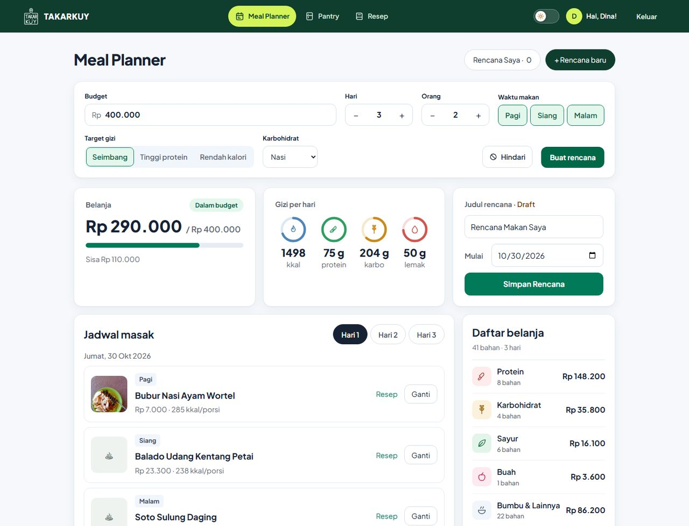 | 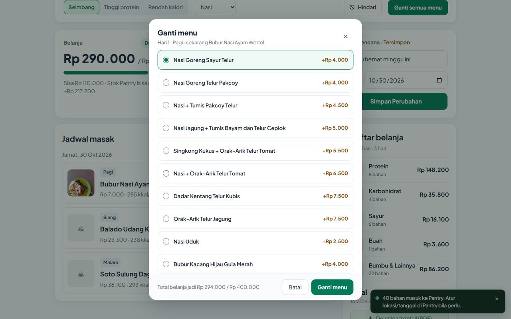 |
| **Modul 1 → 2 — Belanjaan masuk ke Pantry** | **Modul 2 — Stok dapur** |
| 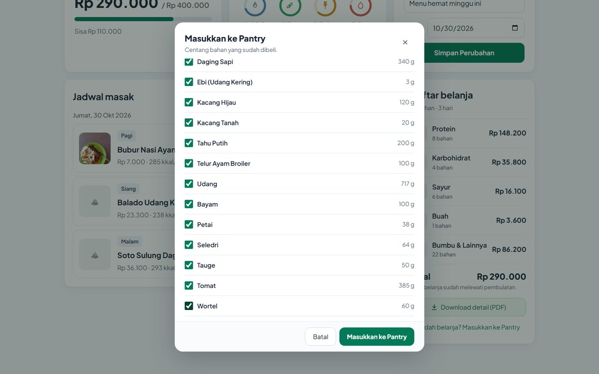 | 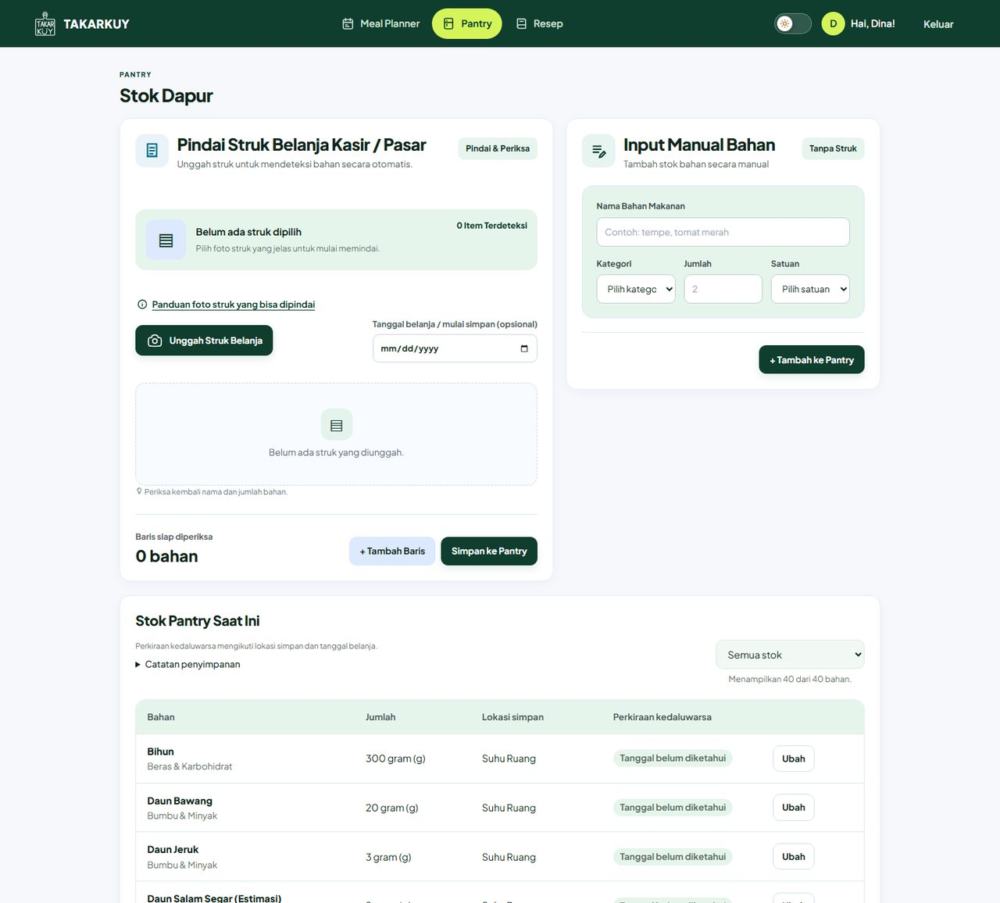 |
| **Modul 2 — Panduan pindai struk** | **Modul 3 — Preferensi makanan** |
| 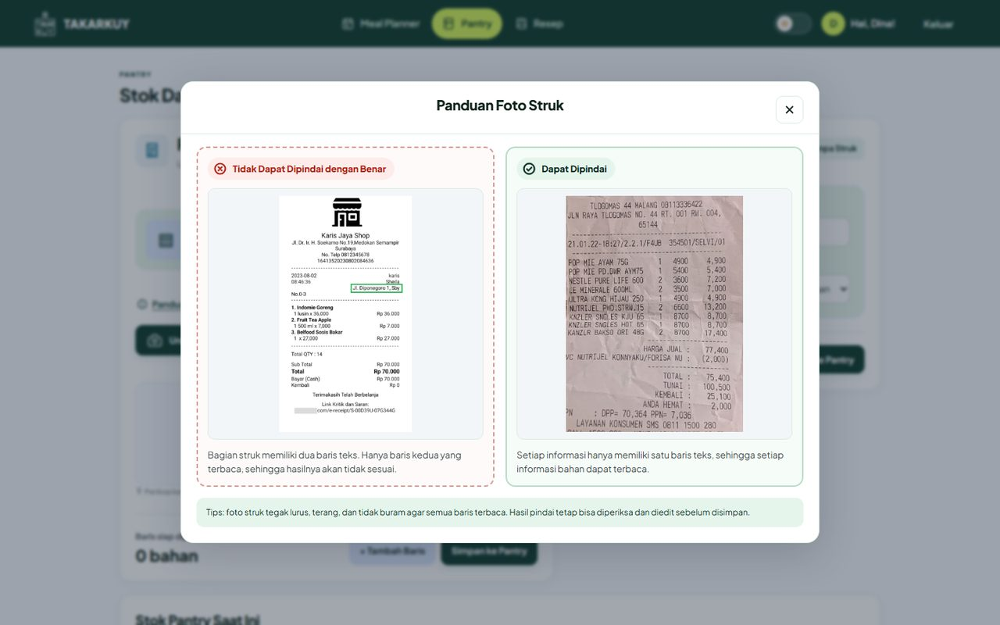 | 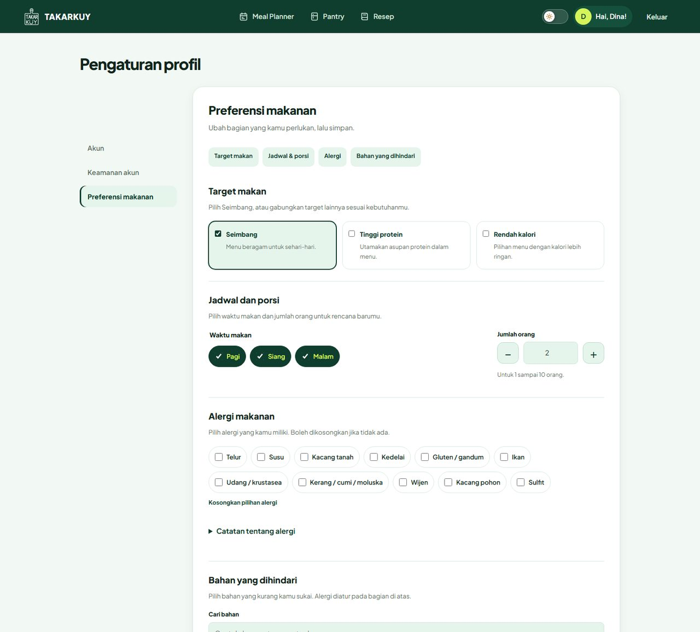 |
| **Modul 4 — Detail resep** | **Modul 4 → 2 — Sudah Masak mengecek stok** |
| 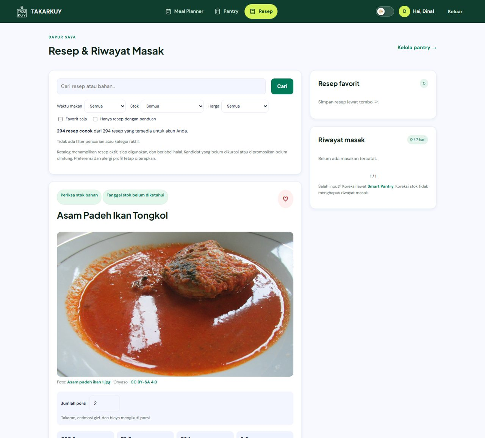 | 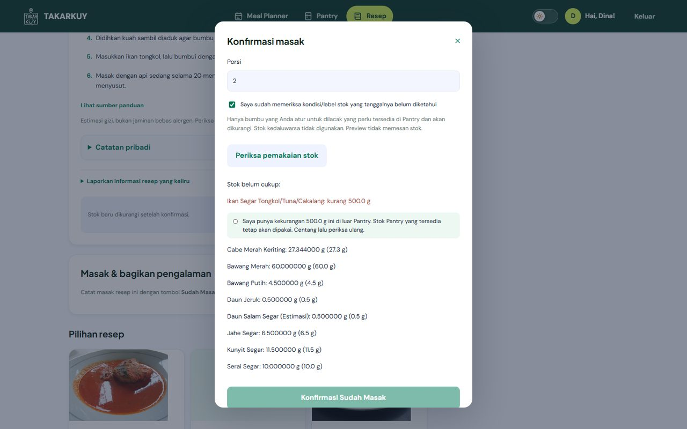 |
| **Modul 5 — Dashboard** | **Modul 5 — Pasar terdekat** |
| 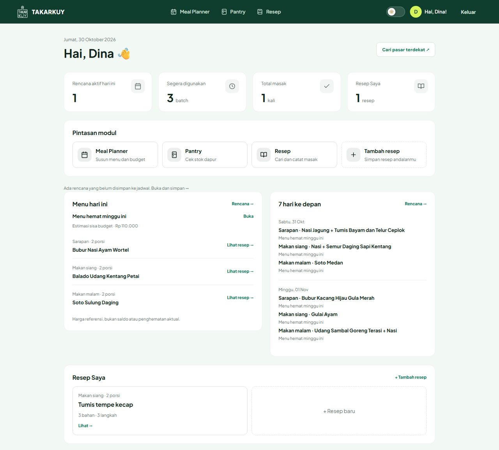 | 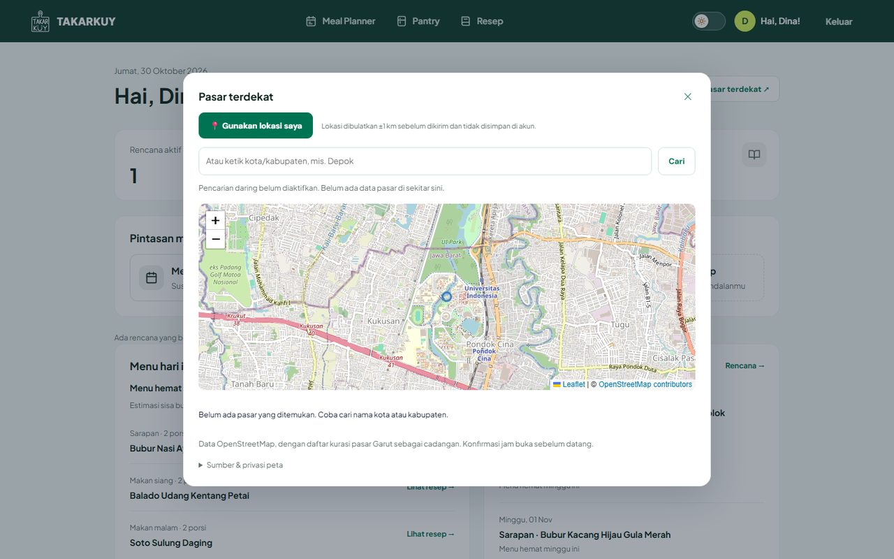 |

## Public API

| API | Modul | Kegunaan dan penanganan data |
| --- | --- | --- |
| [OpenStreetMap](https://www.openstreetmap.org/) — Nominatim dan Overpass | 5 (Dashboard) | Mencari pasar tradisional terdekat dari lokasi pengguna. Hasil disimpan di cache server 7 hari, dibatasi kuota per akun, dan memakai timeout. Jika server OSM gagal, daftar pasar kurasi tetap tampil. |
| [Gemini API](https://ai.google.dev/) | 2 (Pantry) | Cadangan OCR struk dan pencocokan nama bahan, hanya dipanggil saat Tesseract.js kurang yakin. Hasil di-cache 30 hari dan dibatasi kuota harian per akun. Tanpa API key, Pantry tetap berjalan dengan Tesseract.js dan input manual. |
| [TheMealDB API](https://www.themealdb.com/docs_api_guide.php) | 4 (Recipe Book) | Sumber kandidat resep internasional saat membangun katalog. Data dikurasi dan disimpan ke database, sehingga aplikasi tidak memanggil API ini saat berjalan. |

Rincian cara kerja, pengaturan, sumber dataset, dan lisensinya ada di [DATA_API.md](DATA_API.md).

## Teknologi dan Data Pendukung

| Teknologi / Data | Kegunaan di TAKARKUY |
| --- | --- |
| Django 5.2 (Python 3.13) | Kerangka aplikasi dengan pola MTV; setiap modul adalah app Django tersendiri. |
| PostgreSQL / SQLite | PostgreSQL di PWS dan CI; SQLite untuk pengembangan lokal. |
| WhiteNoise dan Gunicorn | Melayani berkas statis dan menjalankan aplikasi di PWS. |
| [Tesseract.js](https://github.com/naptha/tesseract.js) | OCR untuk membaca teks pada foto struk belanja di browser. Hasilnya dapat diedit manual sebelum disimpan ke pantry. Tesseract.js dijalankan sebagai library, bukan Public API. |
| Dataset resep dan harga | Katalog bahan, harga referensi, dan resep Indonesia yang sudah dikurasi (`data/fixtures/catalog_seed.json`). Sumber dan lisensinya ada di [DATA_API.md](DATA_API.md). |

## Peran Pengguna

| Peran | Hak Akses |
| --- | --- |
| Guest | Mengakses landing page dan informasi fitur, serta register/login. Simulasi kalkulator budget bersifat opsional. |
| Registered User | Mengelola budget planner, daftar belanja, Virtual Pantry melalui OCR struk atau input manual, profil dan preferensi, serta resep favorit; melihat resep dan riwayat masak, mencatat **Sudah Masak**, serta mengakses Dashboard dan modal market locator. |
| Administrator | Mengelola master bahan, harga referensi, serta database resep masakan Indonesia. |

## Akses dan Keamanan

- Guest hanya dapat membuka landing, daftar, dan masuk. Kalkulator budget di landing tetap bisa dicoba; isiannya terbawa ke planner setelah pengguna masuk atau daftar (`/login/?next=...`).
- Semua halaman modul wajib login. Setelah masuk, pengguna diarahkan ke Dashboard.
- Ganti kata sandi dibatasi 5 percobaan per akun dan 30 per IP dalam jendela 15 menit. Semua form memakai proteksi CSRF.
- Tampilan memakai satu `base.html` bersama, mendukung mode terang/gelap, dan responsif sampai layar 360px.

## Menjalankan Secara Lokal

**Prasyarat:** Python 3.13, Git, dan (opsional) Node.js untuk menjalankan tes JavaScript.

```bash
git clone https://github.com/PBPUY-11-C/TAKARKUY.git
cd TAKARKUY

python -m venv .venv
# Windows: .venv\Scripts\activate    macOS/Linux: source .venv/bin/activate
pip install -r requirements.txt

python manage.py migrate
python manage.py import_catalog data/fixtures/catalog_seed.json --sync-generated-relations
python manage.py createsuperuser   # opsional, untuk /admin/
python manage.py runserver
```

Buka `http://127.0.0.1:8000/`. Secara lokal aplikasi memakai SQLite dan tidak membutuhkan API key.

**Environment variable** (opsional, ditulis di berkas `.env` pada root proyek; berkas ini tidak ikut ke Git):

| Variabel | Kegunaan |
| --- | --- |
| `PRODUCTION` | `true` di PWS: memakai PostgreSQL, mematikan `DEBUG`, dan mengaktifkan cookie aman. |
| `DJANGO_SECRET_KEY` | Wajib saat `PRODUCTION=true`. |
| `DB_NAME`, `DB_USER`, `DB_PASSWORD`, `DB_HOST`, `DB_PORT`, `SCHEMA` | Koneksi PostgreSQL saat produksi. |
| `PANTRY_LLM_PROVIDER=gemini`, `GEMINI_API_KEY`, `PANTRY_LLM_MODEL` | Mengaktifkan cadangan OCR Gemini di Pantry; `PANTRY_LLM_MODEL` memilih modelnya (kami memakai `gemini-3.5-flash-lite`). |
| `MAP_LOOKUP_ENABLED=true`, `MAP_USER_AGENT` | Mengaktifkan pencarian pasar lewat OpenStreetMap. |
| `MAINTENANCE_MODE` | `true` untuk menampilkan halaman maintenance. |

## Pengujian dan CI/CD

```bash
python manage.py test                  # tes Django
node --test tests/js/*/*.mjs           # tes JavaScript
python data/validate_catalog.py        # validasi data katalog
python manage.py makemigrations --check --dry-run
```

- **CI** (`.github/workflows/tests.yml`): setiap push dan pull request menjalankan validasi data, cek migrasi, tes Django di PostgreSQL, dan tes JavaScript.
- **CD** (`.github/workflows/deploy.yml`): setelah tes di `main` lolos, aplikasi otomatis di-deploy ke PWS.
- **Alur kerja Git:** setiap anggota bekerja di branch modulnya (`modul-1-alfredo`, `modul-2-rajendra`, `modul-3-attar`, `modul-4-alena`, `modul-5-aiko`), menulis commit dengan format *conventional commits* (`feat:`, `fix:`, `test:`, ...), lalu menggabungkan perubahan ke `main` melalui pull request yang di-review anggota lain.

## Struktur Proyek

```text
apps/
  planner/   Modul 1 — Smart Budget Meal Planner
  pantry/    Modul 2 — Smart Pantry
  login/     Modul 3 — akun, profil, dan preferensi (juga memuat landing page Modul 1)
  recipe/    Modul 4 — Recipe Book & Cooking Tracker
  home/      Modul 5 — Dashboard, Resep Saya, dan market locator
  catalog/   data bersama: bahan, harga, resep, alergen
config/      pengaturan Django dan routing global
templates/   base.html, header bersama, dan halaman error
static/      design system bersama (warna, tema, komponen)
data/        dataset, skrip pembangun katalog, dan validator
tests/       tes lintas modul dan tes JavaScript
```

## AI Disclosure

### AI di dalam aplikasi

TAKARKUY memakai **Gemini** (`gemini-3.5-flash-lite`, diatur lewat environment variable `PANTRY_LLM_MODEL`) hanya sebagai cadangan di Smart Pantry, saat Tesseract.js kurang yakin membaca struk. AI tidak pernah menjadi sumber kebenaran:

- Hasil pindai tidak langsung disimpan. Pengguna selalu memeriksa dan mengedit daftar bahan sebelum menyimpannya.
- Kode bahan dari AI dicocokkan ulang dengan katalog; kode yang tidak dikenal dibuang dan dicocokkan secara lokal.
- Perkiraan masa simpan dari AI diberi label dan diganti acuan resmi bila tersedia.
- Pemanggilan dibatasi kuota harian per akun, memakai cache 30 hari, dan foto struk tidak disimpan.
- Tanpa API key, Pantry tetap berjalan dengan Tesseract.js dan input manual.

Prompt, batasan, dan pencatatannya dijelaskan di [DATA_API.md](DATA_API.md).

### AI dalam proses pengembangan

Setiap anggota memakai asisten AI sebagai alat bantu, bukan pengganti pemahaman. Kode dari AI baru masuk ke `main` setelah dibaca, dijalankan, dites, dan digabung lewat pull request.

| Anggota | Alat AI | Dipakai untuk | Yang diperiksa dan diperbaiki manual |
| --- | --- | --- | --- |
| Alfredo (Modul 1) | Claude | Menyusun logika planner dan tesnya, redesign landing page, memecah JavaScript planner menjadi modul ES, menyiapkan CI/CD, serta merapikan README dan dokumentasi. | Menentukan desain dan teks landing page lewat beberapa putaran revisi, mencocokkan hasil rencana dengan budget dan data katalog, menjalankan tes dan mengecek tampilan di browser sebelum commit. |
| Rajendra (Modul 2) | ChatGPT | Membantu tampilan tabel stok dan kartu di HP, filter kedaluwarsa, modal panduan struk, serta tes Pantry. | Menyamakan tampilan dengan halaman lain, mengecek mode gelap, dan menguji alur input stok secara langsung. |
| Attar (Modul 3) | Claude | Membantu pemisahan halaman profil, preferensi, dan ganti kata sandi, perbaikan celah login, serta tes akun. | Mengecek navigasi keyboard, fokus popup, dan keterbacaan di mode gelap; memastikan halaman yang wajib login tidak bisa dilewati. |
| Alena (Modul 4) | ChatGPT | Membantu fitur mode memasak, ulasan dan moderasi foto, penyesuaian porsi, serta kurasi data resep. | Memeriksa takaran dan langkah resep, alur moderasi foto, dan jumlah query pada halaman resep. |
| Aiko (Modul 5) | ChatGPT | Membantu CRUD Resep Saya, tampilan Dashboard, serta unit test Modul 5. | Mengecek data Dashboard terhadap rencana, stok, dan riwayat masak, serta alur tambah, ubah, dan hapus resep. |

**Strategi prompt yang kami pakai:**

1. **Beri konteks, bukan hanya perintah.** Kami menyertakan file terkait, aturan proyek, dan contoh kode yang sudah ada agar hasil AI mengikuti struktur dan gaya kode kami.
2. **Minta perubahan kecil dan spesifik.** Satu prompt untuk satu masalah atau fitur, agar hasilnya mudah dibaca dan direview.
3. **Minta tes dan bukti.** AI diminta menulis atau memperbarui tes, lalu kami menjalankan sendiri seluruh tes sebelum menerima hasilnya.
4. **Tetapkan batasan.** Misalnya: data di folder `data/` tidak boleh dihapus, dan commit serta push dilakukan sendiri oleh anggota.

**Keterbatasan AI yang kami temui:**

- **Lolos tes belum tentu benar di layar.** Beberapa perubahan tampilan lolos tes otomatis tetapi tetap perlu dicek di browser, misalnya jarak antarelemen dan tampilan di layar HP 360–390px.
- **Konteks yang terbatas.** AI tidak selalu tahu fitur yang sudah dihapus atau diganti anggota lain, sehingga deskripsi modul sempat tidak sesuai dengan kode terbaru dan harus dicocokkan ulang.
- **Data pangan perlu diverifikasi.** Angka gizi, harga, dan masa simpan dari AI tidak dipakai langsung. Data katalog berasal dari sumber yang tercatat di [DATA_API.md](DATA_API.md), dan estimasi diberi label.
- **Saran yang terlalu luas.** AI kadang mengusulkan perubahan di luar cakupan atau menyentuh modul anggota lain. Perubahan seperti itu kami tolak atau sampaikan ke pemilik modulnya.

**Cara kami mengendalikannya:** setiap perubahan lewat pull request ke `main`, tes otomatis di CI (Django dan JavaScript), dan review anggota lain sebelum di-merge. Tanggung jawab atas kode tetap ada pada anggota yang meng-commit-nya.
